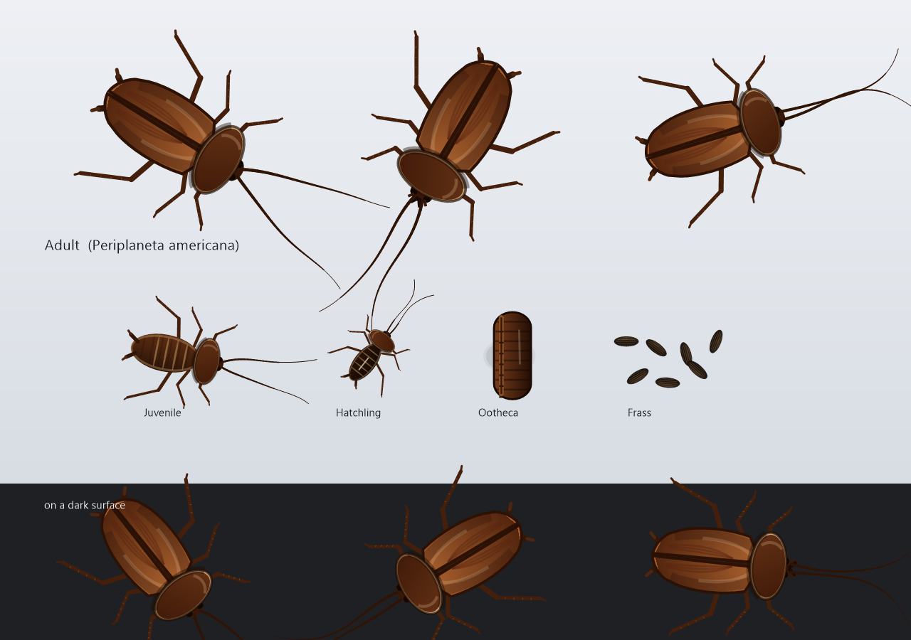

# American Roach Pet

[简体中文](README.md) | **English**

> One (well, twenty-six) American cockroaches living on your Windows desktop. They hide under icons, poke their antennae out from the edge of a file, nibble your shortcuts, and scatter in panic when you move something around.



| | |
|---|---|
| Version | v1.1.1 |
| Platform | Windows 7 SP1 or later (x64, PerMonitorV2 DPI aware) |
| Binary | `bin/RoachPet.exe`, ~341 KB |
| Code | 7 source files, ~3,400 lines of C++17 |
| Toolchain | MinGW-w64 g++ 16.2.0 (UCRT) |

---

## Quick start

```bash
# build
./build.sh

# run
./bin/RoachPet.exe
```

The build script does exactly two things: compile the resources (manifest + icon) with `windres`, then compile and link every source file in one pass.

```bash
g++ -std=c++17 -municode -mwindows -Os -s -static \
    -Isrc src/config.cpp src/render.cpp src/desktop.cpp src/zorder.cpp \
         src/bug.cpp src/app.cpp build/app.res \
    -o bin/RoachPet.exe \
    -lgdiplus -lole32 -loleaut32 -luuid -lcomctl32 -lshell32 -lshlwapi \
    -lwinmm -lgdi32 -luser32 -ladvapi32 -ldwmapi
```

> The linker may print `.rsrc merge failure: multiple non-default manifests`. That is MinGW resource-merging noise — the manifest is embedded correctly (verify with `strings bin/RoachPet.exe | findstr dpiAware`). `-Wl,--no-default-manifest` is not supported by this toolchain, so the warning stays.

### Command line

| Argument | Effect |
|---|---|
| *(none)* | Normal start. Single instance — launching again opens the Settings window of the running copy |
| `--settings` | Open Settings immediately after start |
| `--restore` | Restore only: give every hidden file its attributes back, then exit (crash recovery) |
| `--restore --quiet` | Same, without the message box (for scripts / automation) |

---

## What it does

### Four life stages

| Stage | Look | Behaviour |
|---|---|---|
| Ootheca | Dark brown purse shape with transverse ridges | Never moves. Tucks under an icon and hatches in place after 70–90 s |
| Hatchling | Wingless, dark, proportionally longer antennae | Always under files; moults into a juvenile after 55 s |
| Juvenile | Wingless, clearly segmented abdomen | Crawls mostly where icons are dense; becomes an adult after 70 s |
| Adult | Dark pronotal shield, wing seam, spiny tibiae | Roams both the crowded areas and the empty wallpaper, fastest of the four |

Speed multipliers: adult 1.00 / juvenile 0.78 / hatchling 0.58. Body length is derived from the sprite box (ootheca 0.46×, everything else 0.30×).

### Behaviour state machine

`Wander → Flee / Eat / Poop / Hidden / Emerge`

- **Wander** — picks a target inside the icon-dense region (80 px grid) and crawls there, occasionally pausing to rest. Steering has inertia, so it is real locomotion rather than translation.
- **Hidden** — slips under an icon. The body is not drawn at all; only two antennae show. They are clipped against the icon's **real silhouette** (per-row opaque spans read from the icon bitmap's alpha channel), not its bounding box, so an antenna runs all the way to the drawn artwork instead of stopping in mid air over a transparent corner.
- **Emerge / burstOut** — fires when the hiding place is uncovered (you moved the icon) or right after hatching.
- **Flee** — triggered by the cursor passing over (`hover_flee`) or by a neighbour panicking; it cascades to everyone nearby.
- **Eat** — gnaws on the target icon with a mandible animation, then hides that file and leaves frass behind.
- **Poop** — drops frass across the desktop; it follows the same occlusion rules as the insects.

### Eating files (fully reversible)

"Eating" only sets the `Hidden + System` attributes — the equivalent of:

```bat
attrib +s +h "D:\path\to\file.lnk"
```

- Nothing is moved, renamed or modified. The file still launches normally.
- The journal is written *before* the attribute change. **If the journal write fails, the change is rolled back immediately** — a file is never hidden without a record.
- Read-only files, and files that already carry Hidden/System, are skipped so the app never fights read-only media or system items.
- After hiding, `SHChangeNotify(SHCNE_UPDATEDIR)` makes Explorer drop the icon right away.

Restoring is the equivalent of `attrib -s -h`; the original attributes are replayed from the journal:

| Entry point | Notes |
|---|---|
| Tray menu → Restore eaten files… | Asks for confirmation |
| Settings → Files (reversible) → Restore all | Shows the current hidden count |
| `RoachPet.exe --restore` | No UI — the option to use after a crash |

### Desktop-layer occlusion

In earlier builds the roach windows were `WS_EX_TOPMOST`, so opening Notepad left antennae floating on top of it. Every insect now runs an occlusion test before it is presented:

1. Every 180 ms, `EnumWindows` collects the rectangles of all windows covering the desktop;
2. System classes (`Progman` / `WorkerW` / `SHELLDLL_DefView` / `SysListView32` / the taskbar), ghost UWP windows reported by `DwmGetWindowAttribute(DWMWA_CLOAKED)`, `WS_EX_TRANSPARENT` windows, fully transparent layered windows, minimised windows and zero-sized windows are filtered out. So are **shell overlays** (`XamlExplorerHostIslandWindow` and other XAML islands, plus untitled non-activatable tool windows) — dragging a window makes Windows raise a full-screen snap preview, and treating it as an occluder made the whole colony vanish for the duration of the drag, which looked exactly like a freeze;
3. The sprite rectangle is intersected with that set:
   - **fully covered** → `ShowWindow(SW_HIDE)`, not a single pixel is drawn;
   - **partially covered** → each intersecting rectangle is excluded via GDI+ `SetClip(CombineModeExclude)`, so a roach appears to crawl out from behind the window edge and never covers window content;
4. When several windows each cover a corner and together cover everything, five sample points (four corners + centre) decide the case, avoiding the in-between state where the whole sprite would composite to fully transparent.

The frass layer uses the same clipping. The behaviour can be switched off (`hide_on_app=0`), which returns the insects to a permanently on-top desktop pet.

---

## Settings

The Settings window is DPI-scaled, so nothing is clipped at 125% / 150%; if it would exceed the work area height it is rebuilt one step smaller.

| Section | Key | Default | Meaning |
|---|---|---|---|
| Appearance | `scale_pct` | 100 | Scale 70 / 85 / 100 / 120 / 145 / 170 % |
| Appearance | `opacity` | 100 | Opacity 30–100 |
| Appearance | `lang` | 0 | 0 Simplified Chinese / 1 English |
| Appearance | `tray` | 1 | Show tray icon |
| Appearance | `debug_bg` | 0 | Debug background (semi-transparent fill to check window bounds) |
| Behaviour | `hover_flee` | 1 | Flee when the cursor passes over |
| Behaviour | `eat_files` | 1 | Allow eating files |
| Behaviour | `poop` | 1 | Produce frass |
| Behaviour | `hide_on_app` | 1 | Hide when covered by a window (float on the desktop otherwise) |
| Behaviour | `flee_speed` | 100 | Flee speed in percent, 50–300 (cap is 3× the default) |
| Behaviour | `starve` | 0 | The colony dies off when no food is left (one roach every 18–35 s) |
| Display | `monitor` | 0 | 0 = all monitors / 1..N = a specific screen |
| Display | `bounds` | 0 | 0 = work area (avoid the taskbar) / 1 = full monitor |
| Display | `hide_fullscreen` | 1 | Auto-hide in fullscreen apps (games, presentations) |
| Performance | `fps` | 24 | FPS cap 10 / 15 / 24 / 30 / 60 / 0 = follow the monitor refresh rate |
| Performance | `idle_throttle` | 1 | Throttle when idle |
| Performance | `max_bugs` | 26 | Population cap 3–1000 |
| Performance | `low_priority` | 1 | Run at IDLE priority class |
| Files | `eat_interval` | 40 | Minimum seconds between two meals |
| Files | `max_hidden` | 200 | Maximum files hidden at the same time |
| Misc | `autostart` | 0 | Start with Windows (writes `HKCU\...\Run`) |
| Misc | `click_through` | 0 | Click-through — clicks land on the desktop |

The initial population is derived from `max_bugs`: adults 30% (min 3), juveniles 50% (min 2), hatchlings 20% (min 1). Oothecae sit outside the ratio — one per 2–5 adults, scaling with the colony. Growing up (hatchling → juvenile → adult) only counts time spent scurrying in the open; hiding under an icon or fleeing does not age a nymph.

### Hotkeys

All three hotkeys can be redefined in Settings: click a row, then press the new combination (Esc cancels).

| Default | Action |
|---|---|
| `Ctrl + Alt + R` | Show / hide the pet |
| `Ctrl + Alt + S` | Open Settings |
| `Ctrl + Alt + Q` | Quit |

If registration fails (another app owns the combination) startup still succeeds — only that binding is inactive.

---

## File locations

| What | Where |
|---|---|
| Configuration | `%APPDATA%\RoachPet\config.ini` |
| Eating journal | `%APPDATA%\RoachPet\eaten.tsv` |
| Runtime log | `%APPDATA%\RoachPet\roachpet.log` |

`config.ini` is written with every default key on first run, so it can be edited directly; it is saved again on exit.

`eaten.tsv` holds one `path<TAB>original attributes` line per file and is deleted once everything has been restored.

---

## Layout

```
roachpet/
├── build.sh              build script
├── bin/RoachPet.exe      the binary
├── src/
│   ├── common.h          shared types: Stage / BState / Config / API
│   ├── config.cpp        ini I/O, bilingual string table, autostart, logging
│   ├── desktop.cpp       icon enumeration (cross-process SysListView32), hide/restore
│   ├── zorder.cpp        desktop-layer occlusion: window rect collection & filtering
│   ├── render.cpp        GDI+ vector art: adult/nymph/hatchling/ootheca/frass/antennae
│   ├── bug.cpp           behaviour state machine, layered window, clipping, eat & poop
│   └── app.cpp           main loop, settings dialog, tray, hotkeys, single instance
├── res/                  manifest and icon script
├── tools/                debug helpers (not shipped)
└── build/                intermediate output and art sheets
```

### Debug helpers

Development-only, not part of the release:

| Tool | Purpose |
|---|---|
| `shot.exe <out.png> [x y w h]` | Full-screen or region capture |
| `crop.exe <in> <out> x y w h [scale]` | Crop and nearest-neighbour zoom |
| `snapwin.exe` | Capture a specific window (DPI aware) |
| `winlist.exe` | List every window's class, rect and visibility |
| `winctl.exe <class> [top\|activate\|move x y\|close]` | Drive a window |
| `maxwin.exe <class> [restore]` | Maximise / restore a window |
| `deskicon.exe list\|move` | Read or move desktop icons |
| `drag.exe <class> dx dy [steps] [ms]` / `drag.exe @ x y dx dy` | Simulate dragging a window or a desktop icon |
| `bugpos.exe` | List every pet window's rect and visibility (touches no other process, safe mid-drag) |
| `icontest.exe` | Print the opaque-silhouette stats of desktop icons |
| `masktest.exe <out.png>` | Render a "rect clip vs silhouette clip" comparison |
| `roachctl.exe <toggle\|settings\|pause\|clean\|restore\|quit>` | Command a running instance |
| `preview.exe <out.png>` | Render the art sheet |

---

## Artwork

Every sprite is a GDI+ path in `src/render.cpp`, which is why antennae, legs and mandibles can animate independently per frame:

- **Antennae** — 30 tapered segments, width falling linearly from `1.00` at the base to `0.30`, base anchored at `0.488L` (front of the head), swinging per frame by phase;
- **Legs** — three pairs with tibial spines, driven by a gait phase that alternates front and rear;
- **Forewings** — central seam plus a transverse texture gradient, with the dark pronotal shield;
- **Frass** — irregular ellipsoids, dark brown to near-black, randomly rotated and sized.

Regenerate the art sheet (any time, after touching `render.cpp`):

```bash
g++ -std=c++17 -municode -O2 -Isrc tools/preview.cpp src/render.cpp \
    -o build/preview.exe -lgdiplus -lgdi32 -luser32 -lole32 -luuid
./build/preview.exe build/art.png                                    # 1280×900, all stages
./build/crop.exe build/art.png build/art_detail.png 60 20 700 330 2  # adult at 2×
```

---

## Known limitations

- **Icon enumeration depends on Explorer.** Positions come from `SysListView32` + `LVM_GETITEMPOSITION` across processes. If the desktop is taken over by a third-party shell (some dock tools do this), positions may be unreadable and the insects will only roam the empty wallpaper.
- **Virtual desktops are not handled** — the pet only lives on the current desktop.
- **Fullscreen detection** compares the foreground window rect with the monitor rect; some borderless fullscreen games slip through.
- **Elevation**: if Explorer runs elevated and this app does not, the cross-process icon read fails.
- **An ootheca never walks** — by design (real ones don't). Moving the icon simply exposes it.

## License

[MIT](LICENSE) © 2026 JHong

The program never deletes or edits your files — it only changes attributes, and it keeps a journal so everything can be undone.
