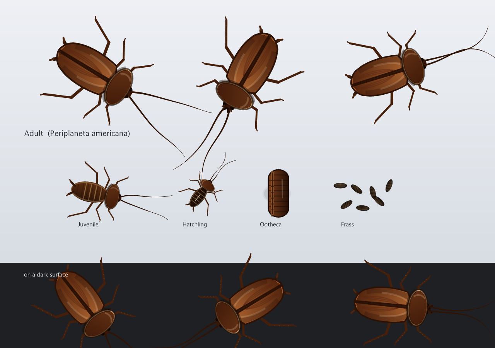
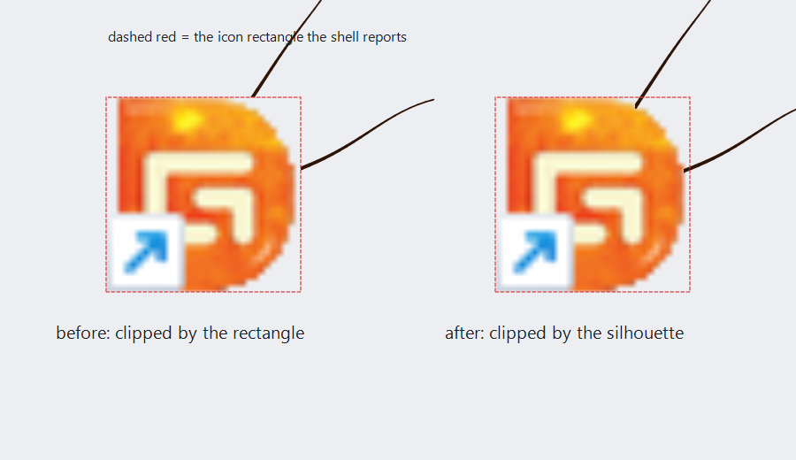

# 美洲大蠊桌宠 · American Roach Pet

**简体中文** | [English](README.en.md)

> 一只（其实是二十六只）生活在 Windows 桌面上的美洲大蠊。它们会躲在图标底下、从文件边缘探出触须、啃食快捷方式，并在你挪动文件时四散惊逃。



| 项目 | 值 |
|---|---|
| 版本 | v1.1.1 |
| 平台 | Windows 7 SP1 及以上（x64，PerMonitorV2 DPI 感知） |
| 产物 | `bin/RoachPet.exe`，约 341 KB |
| 代码 | 7 个源文件，约 3400 行 C++17 |
| 构建 | MinGW-w64 g++ 16.2.0（UCRT） |

---

## 快速开始

```bash
# 构建
./build.sh

# 运行
./bin/RoachPet.exe
```

构建脚本只做两件事：`windres` 编译资源（清单 + 图标），然后一次性编译链接全部源文件。

```bash
g++ -std=c++17 -municode -mwindows -Os -s -static \
    -Isrc src/config.cpp src/render.cpp src/desktop.cpp src/zorder.cpp \
         src/bug.cpp src/app.cpp build/app.res \
    -o bin/RoachPet.exe \
    -lgdiplus -lole32 -loleaut32 -luuid -lcomctl32 -lshell32 -lshlwapi \
    -lwinmm -lgdi32 -luser32 -ladvapi32 -ldwmapi
```

> 链接时 ld 可能报 `.rsrc merge failure: multiple non-default manifests`，这是 MinGW 资源合并的噪声，清单已正确嵌入（可用 `strings bin/RoachPet.exe | findstr dpiAware` 验证）。加 `-Wl,--no-default-manifest` 在本工具链上不被支持，故保留。

### 命令行参数

| 参数 | 作用 |
|---|---|
| 无 | 正常启动（单实例，重复启动会唤出已有实例的设置窗口） |
| `--settings` | 启动后直接打开设置 |
| `--restore` | 只做还原：把所有被本程序隐藏的文件恢复属性，然后退出（崩溃兜底用） |
| `--restore --quiet` | 同上，但不弹提示框（适合脚本 / 自动化） |

---

## 它会做什么

### 四种形态

| 形态 | 外观 | 行为 |
|---|---|---|
| 卵鞘 Ootheca | 深褐色钱袋状，带横向棱脊 | 不移动，藏在图标底下，70–90 秒后原地孵化 |
| 幼虫 Hatchling | 无翅，深色，触须相对更长 | 全部躲在文件底下；孵化后 55 秒蜕变为若虫 |
| 若虫 Juvenile | 无翅，腹部节纹清晰 | 多在图标密集处爬行，若虫 70 秒后羽化为成虫 |
| 成虫 Adult | 前胸背板深色斑、前翅中缝、六足胫刺 | 在文件密集处与空白处游走，速度最快 |

移动速度比：成虫 1.00 / 若虫 0.78 / 幼虫 0.58。体型由精灵盒尺寸推导（卵鞘 0.46×，其余 0.30×）。

### 行为状态机

`Wander → Flee / Eat / Poop / Hidden / Emerge`

- **Wander**：在图标密集区（80 px 网格）里挑目标点爬行，偶尔停下歇一会儿；转向带惯性，不是直线平移。
- **Hidden**：钻进某个图标底下，身体完全不绘制，只露出两根触须。触须的裁切依据是图标的**真实轮廓**（从图标位图的 alpha 通道逐行取不透明区间），而不是它那个矩形外框——所以触须能一直伸到图标图案的边缘才消失，不会在图标外侧的透明角落里凭空断掉。
- **Emerge / burstOut**：藏身处被掀开（你挪了图标）或刚孵化时，从图标底下冲出来。
- **Flee**：鼠标划过（`hover_flee`）、或附近有同类惊逃时触发，会连锁引起周围个体一起跑。
- **Eat**：对着目标图标啃食，有上颚开合动画，结束后隐藏该文件并排泄。
- **Poop**：排出粪便，散布在桌面，跟随桌面层遮挡关系。

图标轮廓裁切的效果对比——左边按矩形裁切，触须在图标外框处被生硬切断；右边按真实轮廓裁切，触须一直伸到图案边缘：



### 啃食文件（可逆）

“吃”只是给文件加上 `隐藏 + 系统` 属性，等价于：

```bat
attrib +s +h "D:\path\to\file.lnk"
```

- 不移动、不重命名、不修改内容，文件照常可以双击运行。
- 每次隐藏前先写日志，**写日志失败就立刻回滚**，绝不隐藏无法还原的文件。
- 只读文件、已带隐藏/系统属性的文件会被跳过，避免和只读介质或系统项打架。
- 隐藏后调用 `SHChangeNotify(SHCNE_UPDATEDIR)` 让资源管理器立刻刷掉图标。

还原等价于 `attrib -s -h`，属性按日志里记录的原始值恢复：

| 入口 | 说明 |
|---|---|
| 托盘菜单 → 还原被吃掉的文档 | 带确认框 |
| 设置 → 文件（可逆）→ 还原全部 | 显示当前隐藏数量 |
| `RoachPet.exe --restore` | 不开 UI，适合程序崩溃后使用 |

### 桌面层遮挡（v1.1.1 核心）

早期版本里蟑螂窗口是 `WS_EX_TOPMOST` 的，打开记事本会看到触须浮在窗口之上。现在每只蟑螂在呈现前都会做一次遮挡判定：

1. 每 180 ms 用 `EnumWindows` 收集所有覆盖桌面的窗口矩形；
2. 过滤掉系统类（`Progman` / `WorkerW` / `SHELLDLL_DefView` / `SysListView32` / 任务栏）、`DwmGetWindowAttribute(DWMWA_CLOAKED)` 报出的幽灵 UWP、`WS_EX_TRANSPARENT`、全透明分层窗口、最小化与零尺寸窗口；
   另外还跳过**壳层浮层**（`XamlExplorerHostIslandWindow` 等 XAML island、以及无标题且不可激活的工具窗口）——拖动窗口时 Windows 会拉起一个铺满全屏的贴靠预览浮层，若把它当成遮挡物，整群蟑螂会在拖动期间全部消失，看起来就是「卡住了」；
3. 把精灵矩形和这批矩形求交：
   - **完全被盖住** → `ShowWindow(SW_HIDE)`，一个像素都不画；
   - **部分遮挡** → 对每个相交矩形做 GDI+ `SetClip(CombineModeExclude)`，蟑螂像从窗口边缘后面钻出来，绝不覆盖窗口内容；
4. 多个窗口各盖一角、合起来盖满时，额外采样精灵四角 + 中心 5 个点判定，避免出现整张全透明贴图的中间态。

粪便层使用同一套裁切逻辑。设置里可关闭（`hide_on_app=0`），关掉后恢复成常驻桌面。

---

## 设置项

设置窗口按 DPI 缩放，125% / 150% 下不会截断；若高度超出工作区会自动再缩一次。

| 分区 | 配置键 | 默认 | 说明 |
|---|---|---|---|
| 外观 | `scale_pct` | 100 | 缩放 70 / 85 / 100 / 120 / 145 / 170 % |
| 外观 | `opacity` | 100 | 不透明度 30–100 |
| 外观 | `lang` | 0 | 0 简体中文 / 1 English |
| 外观 | `tray` | 1 | 显示托盘图标 |
| 外观 | `debug_bg` | 0 | 调试背景色（半透明底，用来确认窗口边界） |
| 行为 | `hover_flee` | 1 | 鼠标悬停惊逃 |
| 行为 | `eat_files` | 1 | 允许啃食文件 |
| 行为 | `poop` | 1 | 产生粪便 |
| 行为 | `hide_on_app` | 1 | 窗口遮挡时隐藏（不开窗时浮于桌面） |
| 显示 | `monitor` | 0 | 0 全部显示器 / 1..N 指定屏幕 |
| 显示 | `bounds` | 0 | 0 工作区（避开任务栏）/ 1 整块屏幕 |
| 显示 | `hide_fullscreen` | 1 | 全屏应用（游戏、演示）时自动隐藏 |
| 性能 | `fps` | 24 | 帧率上限 10 / 15 / 24 / 30 / 60 |
| 性能 | `idle_throttle` | 1 | 闲置自动降帧 |
| 性能 | `max_bugs` | 26 | 繁殖数量上限 3–80 |
| 性能 | `low_priority` | 1 | 进程降为 IDLE 优先级 |
| 文件 | `eat_interval` | 40 | 两次啃食之间的最短间隔（秒） |
| 文件 | `max_hidden` | 200 | 最多同时隐藏多少个文件 |
| 其它 | `autostart` | 0 | 开机自启（写 `HKCU\...\Run`） |
| 其它 | `click_through` | 0 | 鼠标穿透，点击直接落到桌面 |

初始种群按 `max_bugs` 分配：成虫 32%（≥3）、若虫 20%（≥2）、幼虫 12%（≥1）、卵鞘 14%（≥2），其余靠自然繁殖补足。

### 快捷键

| 组合 | 作用 |
|---|---|
| `Ctrl + Alt + R` | 显示 / 隐藏桌宠 |
| `Ctrl + Alt + S` | 打开设置 |
| `Ctrl + Alt + Q` | 退出 |

注册失败（被其它程序占用）不会导致启动失败，只是该组合失效。

---

## 文件位置

| 内容 | 路径 |
|---|---|
| 配置 | `%APPDATA%\RoachPet\config.ini` |
| 啃食日志 | `%APPDATA%\RoachPet\eaten.tsv` |
| 运行日志 | `%APPDATA%\RoachPet\roachpet.log` |

`config.ini` 首次运行会写入全部默认键，可直接编辑；退出时自动保存。

`eaten.tsv` 每行一条 `路径<TAB>原始属性`，全部还原成功后该文件会被删除。

---

## 目录结构

```
roachpet/
├── build.sh              构建脚本
├── bin/RoachPet.exe      产物
├── src/
│   ├── common.h          公共定义：Stage / BState / Config / 接口声明
│   ├── config.cpp        配置读写、双语字符串表、开机自启、日志
│   ├── desktop.cpp       桌面图标枚举（跨进程 SysListView32）、隐藏/还原
│   ├── zorder.cpp        桌面层遮挡：窗口矩形采集与过滤
│   ├── render.cpp        GDI+ 矢量绘制：成虫/若虫/幼虫/卵鞘/粪便/触须
│   ├── bug.cpp           行为状态机、分层窗口、遮挡裁切、啃食与排泄
│   └── app.cpp           主循环、设置窗口、托盘、热键、单实例
├── res/                  资源清单与图标脚本
├── tools/                调试工具（不随程序发布）
└── build/                中间产物与美术设计图
```

### 调试工具

这些是开发期用的，不参与发布：

| 工具 | 用途 |
|---|---|
| `shot.exe <out.png> [x y w h]` | 全屏或区域截图 |
| `crop.exe <in> <out> x y w h [scale]` | 裁剪并最近邻放大 |
| `snapwin.exe` | 抓取指定窗口（DPI 感知） |
| `winlist.exe` | 列出所有窗口的类名、矩形、可见性 |
| `winctl.exe <class> [top\|activate\|move x y\|close]` | 控制窗口 |
| `maxwin.exe <class> [restore]` | 最大化 / 还原窗口 |
| `deskicon.exe list\|move` | 读取或移动桌面图标 |
| `drag.exe <class> dx dy [steps] [ms]` / `drag.exe @ x y dx dy` | 模拟拖动窗口或桌面图标 |
| `bugpos.exe` | 列出所有桌宠窗口的位置与可见性（不触碰其它进程，拖动中也能用） |
| `icontest.exe` | 打印桌面图标的不透明轮廓统计 |
| `masktest.exe <out.png>` | 生成「矩形裁切 vs 轮廓裁切」对比图 |
| `roachctl.exe <toggle\|settings\|pause\|clean\|restore\|quit>` | 向运行中的实例发命令 |
| `preview.exe <out.png>` | 输出美术设计图 |

---

## 美术

所有形象都由 `src/render.cpp` 用 GDI+ 路径绘制，因此触须、步足、上颚可以逐帧独立动画：

- 触须：30 段细锥形，宽度从基部 `1.00` 线性收到 `0.30`，基部前移到头部前端 `0.488L`，每帧按相位摆动；
- 步足：三对，带胫刺，步态相位驱动前后交替；
- 前翅：中缝 + 横向纹理渐变，前胸背板深色斑；
- 粪便：不规则椭球，深褐到近黑，随机旋转与尺寸。

生成设计图（改完 `render.cpp` 后可随时重出）：

```bash
g++ -std=c++17 -municode -O2 -Isrc tools/preview.cpp src/render.cpp \
    -o build/preview.exe -lgdiplus -lgdi32 -luser32 -lole32 -luuid
./build/preview.exe build/art.png                                    # 1280×900 全形态
./build/crop.exe build/art.png build/art_detail.png 60 20 700 330 2  # 成虫 2× 细节
```

---

## 已知限制

- **图标枚举依赖资源管理器**：通过 `SysListView32` + `LVM_GETITEMPOSITION` 跨进程读取，若桌面被第三方 Shell（如某些 Dock 工具）接管，图标位置可能读不到，此时蟑螂只在空白处活动。
- **不处理虚拟桌面**：只在当前虚拟桌面的桌面上活动。
- **全屏检测**基于前台窗口矩形与显示器矩形比较，某些无边框全屏游戏可能识别不到。
- **管理员权限**：若资源管理器以管理员运行而本程序不是，跨进程读图标会失败。
- **卵鞘无法移动**：设计如此（真实卵鞘不会自己跑），挪开图标只会让它暴露出来。

## 许可

[MIT](LICENSE) © 2026 JHong

程序不会删除或修改你的文件内容——它只会改属性，并且每次都记账，随时可还原。
